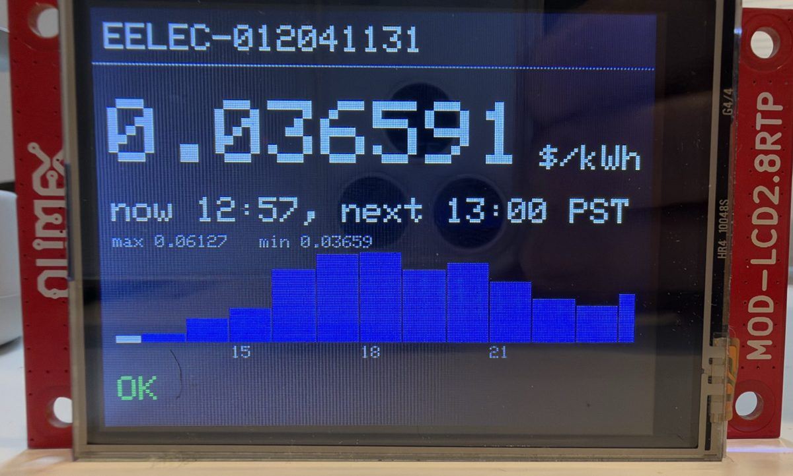
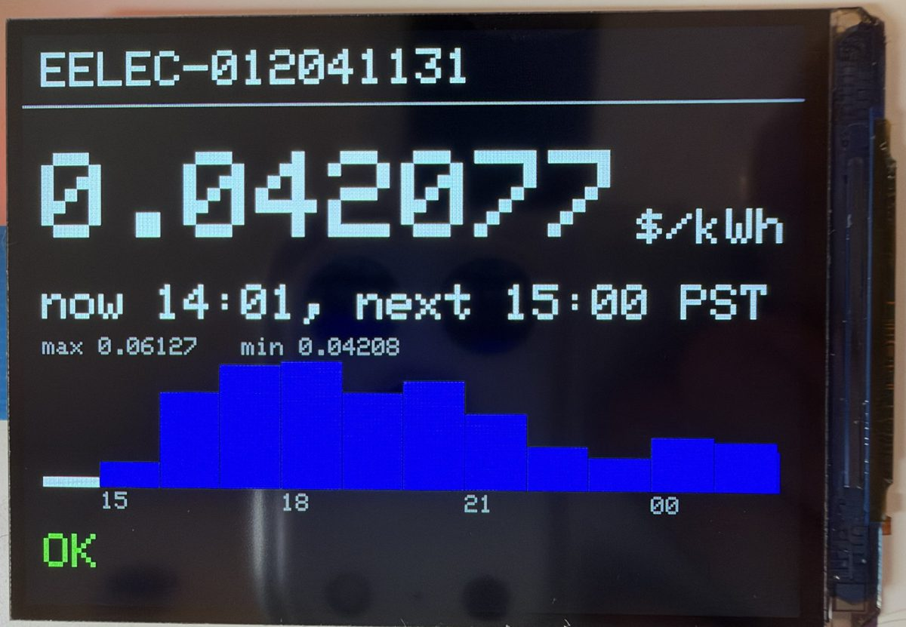

# Displays

A display is a [peripheral](Peripherals.md): any build, in any role, can add one under `peripherals:` and draw on it from its own code. With `oa3: { display: <id> }` the OpenADR 3 VEN draws its [price screen](OpenADR3.md#price-screen) on it, scaled to the panel's size. Two panels are supported.

| Panel | Board | Component | Size | Touch |
|---|---|---|---|---|
| Olimex MOD-LCD2.8RTP, revision C or later | ESP32-POE-ISO or ESP32-POE-ISO-WROVER, on UEXT | `spi/ili9341` | 320x240 | `i2c/ns2009` |
| Olimex MIPI-LCD2.8-640x480 V2 (WLK2802MIPI-15P-V2) | ESP32-P4-DevKit, on MIPI-DSI1 | `dsi/st7701` | 640x480 | none |

## Olimex MOD-LCD2.8RTP on an ESP32-POE-ISO



The module plugs into the board's UEXT connector with its ribbon cable. Leave the microSD slot empty: it shares GPIO 2, 14 and 15 with UEXT.

| UEXT pin | Signal | ESP32 | Used for |
|---|---|---|---|
| 9 | SCK | GPIO14 | ILI9341 clock |
| 8 | MOSI | GPIO2 | ILI9341 data |
| 10 | SSEL | GPIO5 | ILI9341 chip select |
| 7 | MISO | GPIO15 | ILI9341 D/C |
| 6 | SDA | GPIO13 | NS2009 touch |
| 5 | SCL | GPIO33 on the WROVER; GPIO16 on boards without PSRAM | NS2009 touch |

```yaml
buses:
  spi: { pin_sck: 14, pin_mosi: 2 }        # write-only: no pin_miso
  i2c: { pin_sda: 13, pin_scl: 33 }        # ESP32-POE-ISO-WROVER

peripherals:
  - id: lcd
    component: spi/ili9341
    config: { pin_cs: 5, pin_dc: 15 }
  - id: touch
    component: i2c/ns2009
    config: { display: lcd }

oa3:
  base_url: https://price.grid-coordination.energy/openadr3/3.1.0
  program_name: EELEC-012041131
  display: lcd
```

`spi/ili9341`'s `rotation` is 0-3, default 1 (landscape). [examples/oa3-price](../examples/oa3-price/README.md) is this setup as a project.

## Olimex MIPI-LCD2.8-640x480 V2 on an ESP32-P4-DevKit



The panel needs an ESP32-P4 with PSRAM: its frame buffer takes 921,600 bytes of it. To connect it:

1. Unpower the board. The ESP32-P4-DevKit's POEv3 PoE module is not isolated, so take the board off PoE before connecting USB to it.
2. Use the **MIPI-DSI1** connector, between the pUEXT socket and the BOOT and RESET buttons. MIPI-CSI1, beside the Ethernet jack, is the camera connector.
3. Lift the connector's latch. Look into the slot for its metal contacts and insert the ribbon with its bare contacts facing them; the blue stiffener faces away from them. Press the latch down.

The ribbon also carries the panel's 3.3 V and I2C; V2 needs no jumper and no other connection.

```yaml
peripherals:
  - id: lcd
    component: dsi/st7701
    config: { rotation: 1 }

oa3:
  base_url: https://price.grid-coordination.energy/openadr3/3.1.0
  program_name: EELEC-012041131
  display: lcd
```

| `rotation` | Orientation |
|---|---|
| 0 | portrait 480x640, ribbon at the top |
| 1 (default) | landscape 640x480, ribbon on the left |
| 2 | portrait, ribbon at the bottom |
| 3 | landscape, ribbon on the right |

`lane_mbps` (default 500) and `dpi_mhz` (default 16) set the DSI link; the defaults are Olimex's figures for this panel. [examples/oa3-price-p4](../examples/oa3-price-p4/README.md) is this setup as a project.

## What a display costs

Measured on an ESP32-POE-ISO-WROVER with the MOD-LCD2.8RTP and the price screen, against the same build without them ([ChoosingABoard.md](ChoosingABoard.md#what-each-feature-costs) has every feature's cost):

| | Flash | Static RAM | Internal RAM |
|---|---|---|---|
| `spi/ili9341` and the price screen | +49,856 bytes | +1,752 bytes | -2.4 KB |
| `i2c/ns2009` touch | +1,920 bytes | +184 bytes | -2.2 KB |

`dsi/st7701`'s frame buffer is in PSRAM.

## Drawing from your own code

A project's `src/` draws through the `Display` interface, by the peripheral's id; hold a `PeripheralLock` across one redraw and call `flush()` at the end, which `dsi/st7701` needs to make the drawing visible:

```cpp
#include <app.h>
#include <peripherals.h>

void setup_app() {
    PeripheralLock l(lcd);
    lcd.clear(Display::kBlack);
    lcd.text(8, 8, "Hello", 3, Display::kWhite, Display::kBlack);
    lcd.flush();
}
```

`width()` and `height()` follow the rotation, and `char_width(size)` and `char_height(size)` give the built-in font's cell, for laying out by the panel's size. [Peripherals.md](Peripherals.md#the-display-interface) has the whole interface, `native()` for drawing with the driver's own library, and [touch](Peripherals.md#touch).
