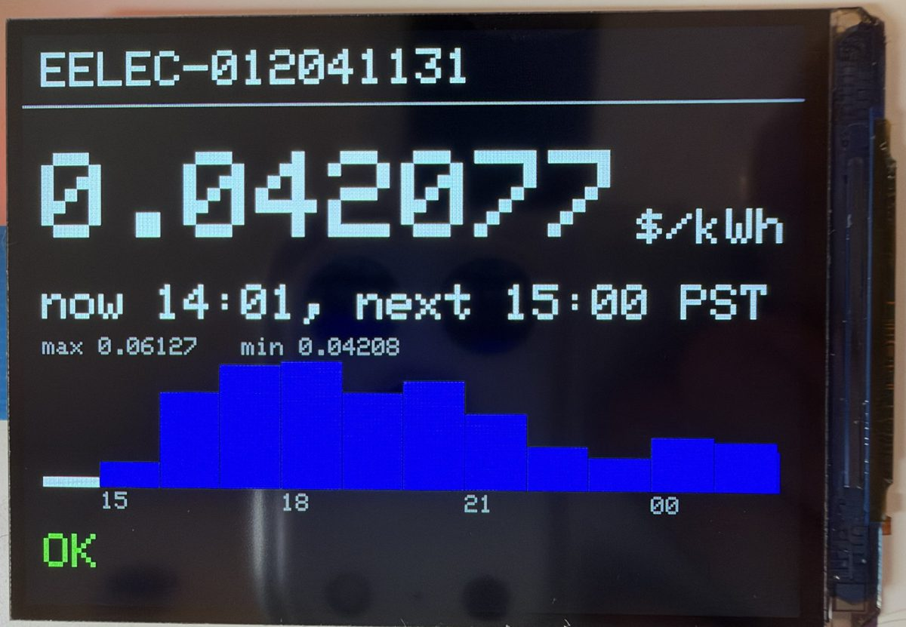

# OpenADR 3 price display on an ESP32-P4

An OpenADR 3 VEN that follows one program on the [price server](https://price.grid-coordination.energy/openadr3/3.1.0) by MQTT notifications and shows the price in force on a 640x480 MIPI-DSI display. It is a `standalone` build: no broker and no Homie device, only the network, the web server and OTA, NTP, the network log, and the VEN.



## Hardware

- Olimex ESP32-P4-DevKit (environment `olimex-esp32-p4-devkit`), with PSRAM: the display's frame buffer takes 921,600 bytes of it.
- Olimex MIPI-LCD2.8-640x480 V2 (WLK2802MIPI-15P-V2) on the board's **MIPI-DSI1** connector with its 15-pin ribbon. MIPI-CSI1, beside the Ethernet jack, is the camera connector. The ribbon also carries the panel's 3.3 V; V2 needs no jumper.

Fit the ribbon with the board unpowered. The ESP32-P4-DevKit's POEv3 PoE module is not isolated, so take the board off PoE before connecting USB to it. [doc/Displays.md](../../doc/Displays.md#olimex-mipi-lcd28-640x480-v2-on-an-esp32-p4-devkit) has the connection steps.

## What it shows

The [price screen](../../doc/OpenADR3.md#price-screen), scaled to the panel: the program, the price and its units, the time now and of the next change, the next 12 hours of prices, and the VEN's status. `rotation: 1` is landscape with the ribbon on the left; set it to suit how the panel is mounted.

The VEN fetches the program's events when it connects, then follows notifications without polling.

## Build and flash

```sh
cp -R examples/oa3-price-p4 ~/oa3-price-p4     # a project of your own
# add ~/oa3-price-p4/config-overlay.yml with device.device_passphrase
./ebus-esp32 build ~/oa3-price-p4
./ebus-esp32 push --port <serial-port> ~/oa3-price-p4
```
